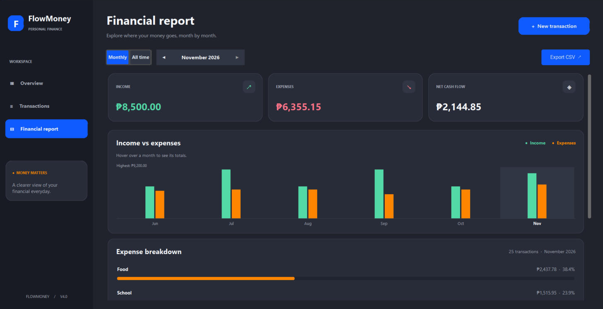

# FlowMoney

**A modern personal expense tracker built with Python.**

FlowMoney is a desktop application designed to help users manage their finances, monitor daily transactions, and understand their spending habits through a clean, modern interface.

## Features

- **Financial Dashboard** — View your total income, expenses, and available balance.
- **Transaction Management** — Add, view, search, and delete transactions.
- **Financial Reports** — Browse month by month (◀ ▶) or view all-time summaries.
- **Income vs Expenses Chart** — Six-month bar chart with hover totals.
- **Smart Categories** — Pick from a dropdown or type a new one; "food" and "Food" stay one category.
- **Expense Breakdown** — Track spending by category.
- **CSV Export** — Export financial reports for use in Excel.
- **Modern Interface** — Charcoal black, royal blue, and tangerine orange design.
- **Local Database** — Transactions are stored securely on your device using SQLite.

## Technologies Used

- Python
- CustomTkinter
- SQLite
- CSV

## Installation

1. Clone the repository:

   `git clone https://github.com/cabilingjohnroy/python-expense-tracker.git`

2. Open the project folder:

   `cd python-expense-tracker`

3. Install the dependencies:

   `python -m pip install -r requirements.txt`

4. Run the application:

   `python app.py`

### Windows shortcuts

These expect a virtual environment in `.venv` (`python -m venv .venv`, then install the requirements into it):

| File | What it does |
|------|--------------|
| `run.bat` | Opens FlowMoney with your real data. |
| `demo.bat` | Opens FlowMoney with sample data in a separate folder, so your real transactions are never touched. |
| `build_exe.bat` | Rebuilds `dist\FlowMoney.exe` with PyInstaller. |

## Running Tests

The database tests use a temporary database, so your real data is never touched:

   `python -m unittest discover tests -v`

## Screenshots

**Financial report** — month navigator, income vs expenses chart, and expense breakdown (sample data):

**Overview**

## Developer

**John Roy Cabiling**

*Built as a personal Python development and portfolio project.*

